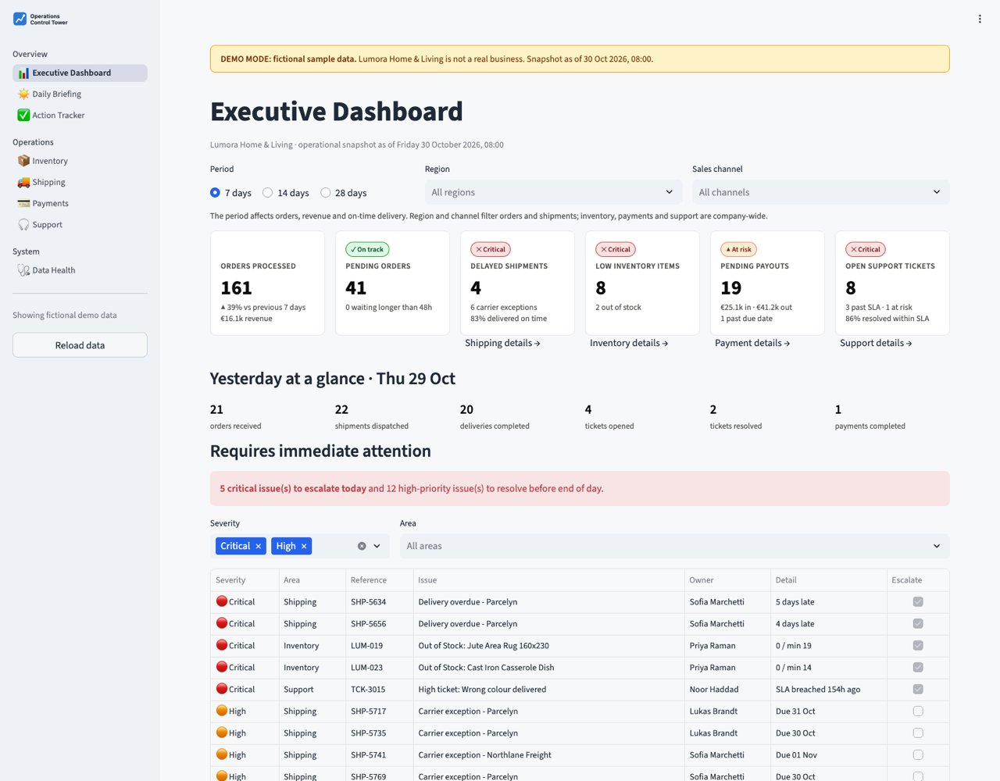
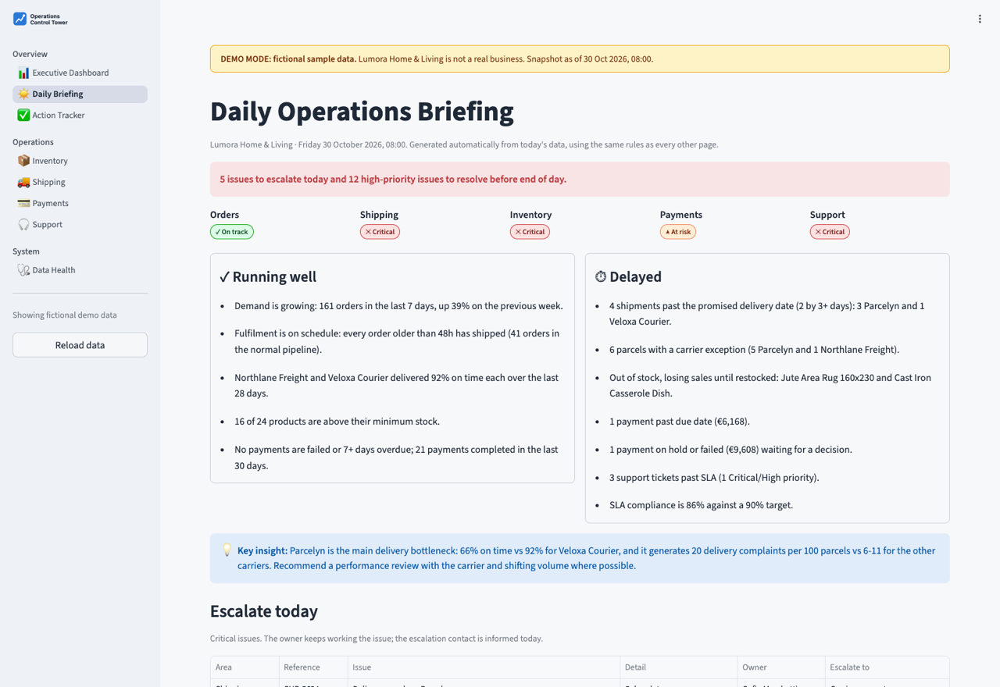
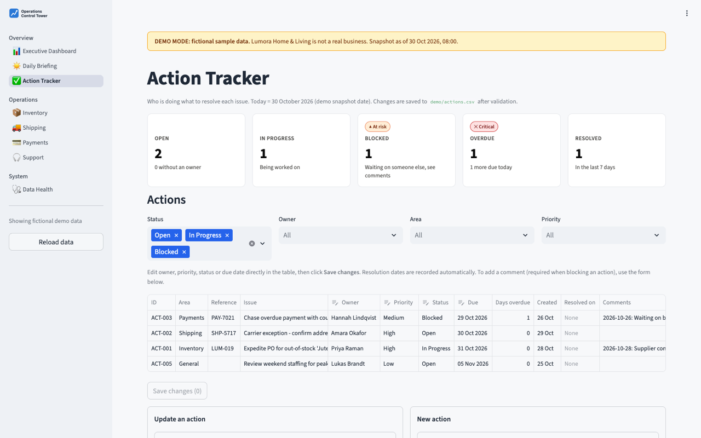
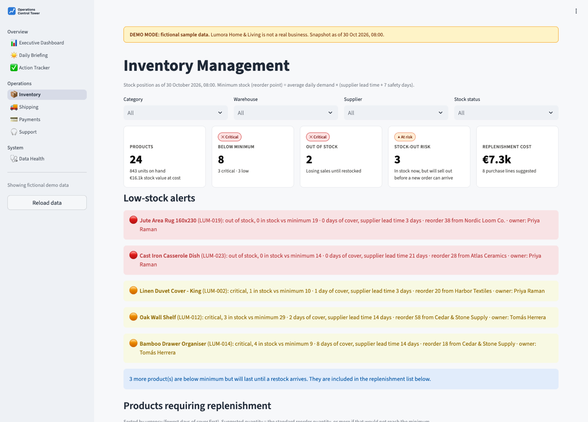
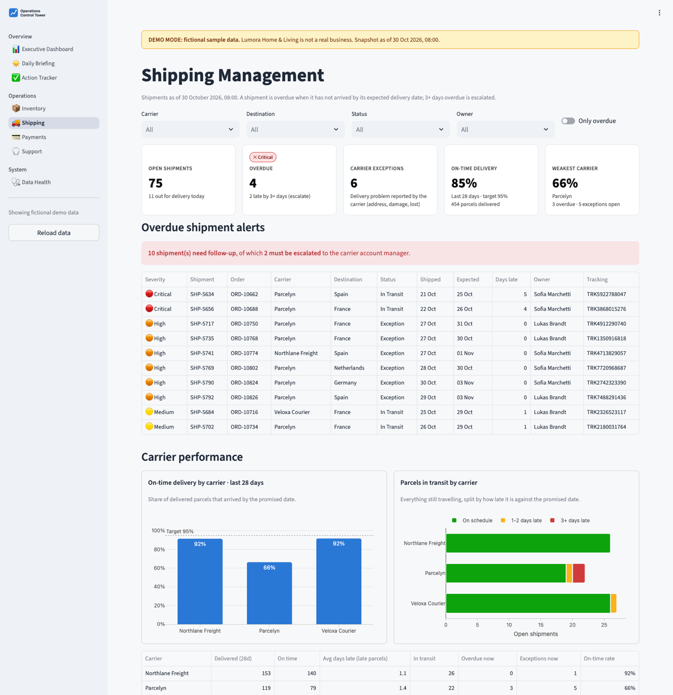
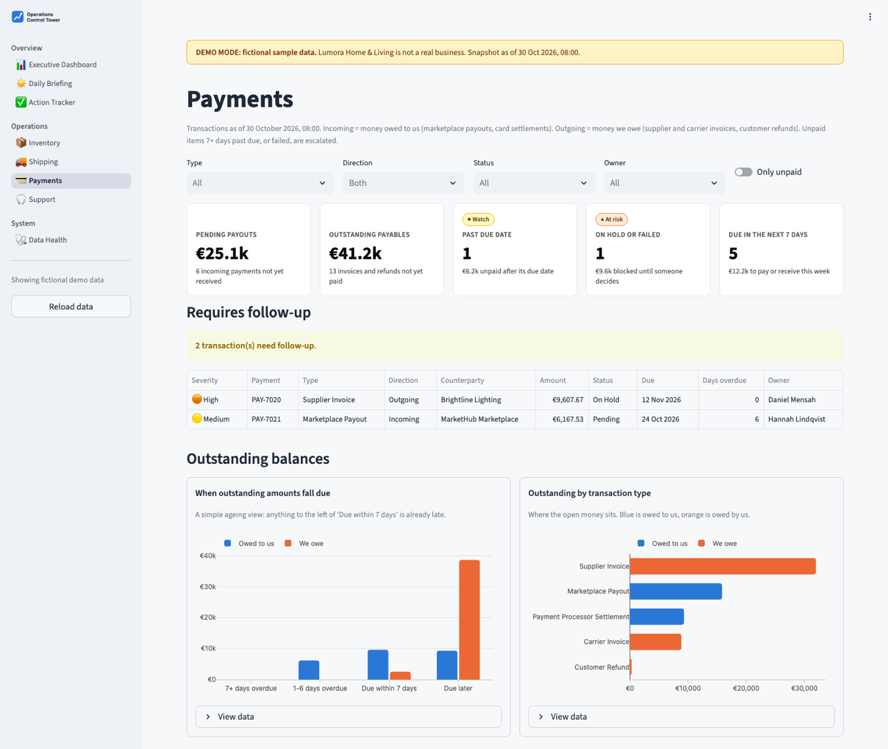
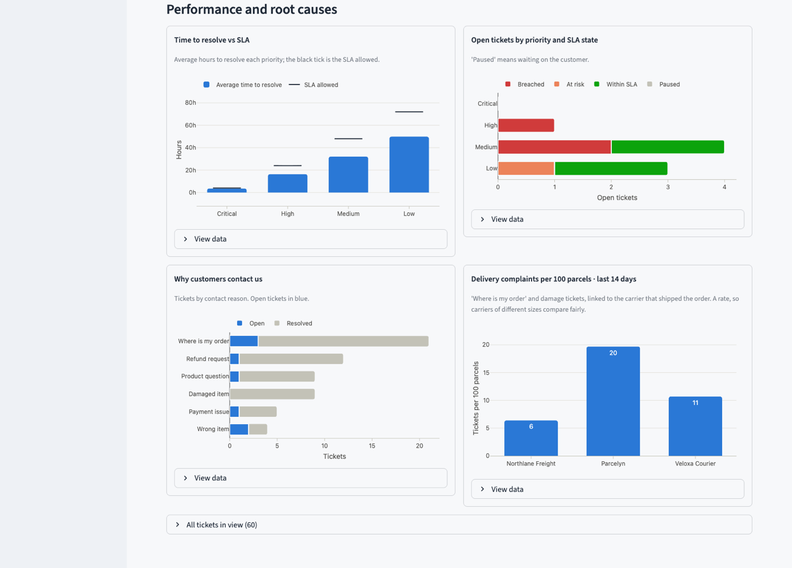
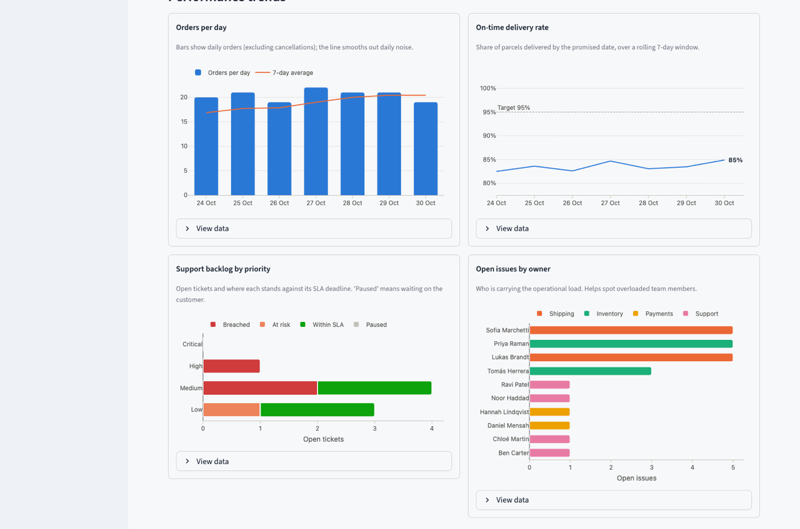

# Operations Control Tower

**One screen for an Operations Manager to monitor orders, shipping, inventory, payments and customer support, spot bottlenecks before they become problems, and make sure every issue has an owner.**

Built with Python, Streamlit, pandas and Plotly as a portfolio project for an Operations Manager role in fast-growing e-commerce.

> **All data in this repository is fictional.** "Lumora Home & Living", its staff, customers, suppliers, carriers and transactions are invented. Every page shows a **DEMO MODE** banner, and the data files are labelled `FICTIONAL DEMO DATA`. Real data can be plugged in separately (see [Using your own data](#using-your-own-data)) and is never committed to git.



## Contents

1. [What it does](#what-it-does)
2. [Screenshots](#screenshots)
3. [Quick start](#quick-start)
4. [Architecture](#architecture)
5. [Business rules and KPIs](#business-rules-and-kpis)
6. [The demo scenario](#the-demo-scenario)
7. [Two-minute interview demo script](#two-minute-interview-demo-script)
8. [Testing](#testing)
9. [Deploying online](#deploying-online)
10. [Using your own data](#using-your-own-data)
11. [Design decisions](#design-decisions)
12. [Limitations and next steps](#limitations-and-next-steps)

---

## What it does

Operations data usually lives in separate tools: the shop platform, the warehouse system, carrier portals, the finance tool, the helpdesk. Problems surface late because nobody sees them side by side. The Control Tower brings them together and answers four questions every morning:

| Question | Where |
|---|---|
| How are we doing? | **Executive Dashboard**: six KPIs, each with a status (On track / Watch / At risk / Critical) |
| What needs a decision now, and who owns it? | **Requires immediate attention** list and the **Daily Briefing** |
| Why is it happening? | Drill-down pages: **Inventory, Shipping, Payments, Support** |
| Is it being handled? | **Action Tracker**: owners, status, comments, resolution dates |

### Modules

| Module | What it shows |
|---|---|
| 📊 **Executive Dashboard** | Orders processed (vs previous period), pending orders, delayed shipments, low inventory, pending payouts, open tickets; yesterday at a glance; severity-ranked attention list; trends (orders, on-time delivery, support backlog, issues per owner). Filters: period, region, sales channel. |
| ☀️ **Daily Briefing** | Auto-generated morning report: what is running well, what is delayed, what needs immediate attention, who is responsible, what to escalate and to whom. Downloadable / copyable for email or chat. |
| ✅ **Action Tracker** | Update status, assign owners, add dated comments, record resolution dates. Create actions straight from open issues. Every change is validated before it is saved. |
| 📦 **Inventory** | Stock vs minimum, days of cover, products that will sell out before a restock can arrive, automatic low-stock alerts, replenishment list with cost (CSV download). |
| 🚚 **Shipping** | Shipment status, overdue alerts with expected dates and owners, carrier on-time scorecard, parcels in transit by lateness. |
| 💳 **Payments** | Pending payouts (owed to us) vs payables (owed by us), past-due and on-hold items with owners, due-date ageing. |
| 🎧 **Support** | Open tickets by priority, SLA deadlines and time left, overdue tickets, time to resolve vs SLA, contact reasons, delivery complaints per 100 parcels by carrier. |
| 🩺 **Data Health** | Validation results for every data file, so bad data is visible instead of silently wrong. |

---

## Screenshots

| | |
|---|---|
|  **Daily Briefing** |  **Action Tracker** |
|  **Inventory** |  **Shipping** |
|  **Payments** |  **Support: root causes** |



---

## Quick start

**Requirements:** Python 3.9 or newer, and git. No paid services, API keys or internet connection are needed to run it.

```bash
# 1. Get the code
git clone https://github.com/franciaolea/Application_to_Gotya.git
cd Application_to_Gotya

# 2. Create an isolated Python environment and install the libraries
python3 -m venv .venv
source .venv/bin/activate          # Windows: .venv\Scripts\activate
pip install -r requirements.txt

# 3. Run the app (opens http://localhost:8501 in your browser)
streamlit run app.py
```

Run the tests:

```bash
pytest -v
```

The demo data is already in the repository. To rebuild it (for example after changing a business rule), or to move every date so the snapshot is "today":

```bash
python -m src.demo_data                 # reproducible snapshot dated 30 Oct 2026
python -m src.demo_data --as-of today   # same scenario, dates relative to today
```

---

## Architecture

```
        CSV files (data/demo or data/live)
                     │
 ① Data layer        src/data_loader.py, src/validation.py
                     │   read as text → validate → convert dates and numbers
 ② Business logic    src/metrics.py, src/briefing.py, src/actions.py
                     │   pure Python + pandas: flags, KPIs, severity, rules
 ③ Presentation      src/ui.py (cards, banner, caching), src/charts.py (Plotly)
                     │
 ④ Pages             app.py (navigation) + views/*.py (one file per screen)
```

Each layer only uses the layers below it. **No file in `src/` except `ui.py` imports Streamlit**, so every business rule can be unit-tested and reused (for example, by a scheduled email job) without the user interface.

### Project structure

```
app.py                     Entry point: page config, sidebar, navigation, demo banner
views/                     One file per page (dashboard, briefing, tracker, modules, data health)
src/
  config.py                Every business rule and threshold in one place
  data_loader.py           Load CSVs: text → validation → typed DataFrames (DataBundle)
  validation.py            Schemas per file + checks (columns, blanks, dates, numbers, values, IDs, links)
  metrics.py               Business logic: enrich records with flags, KPIs, trends, severity, area health
  briefing.py              Daily Briefing: builds the report and its Markdown export
  actions.py               Action Tracker rules, change detection, validated atomic save, demo reset
  charts.py                Plotly charts with one consistent, colour-blind-safe style
  ui.py                    Shared Streamlit pieces: cached loading, KPI cards, status badges, formatting
  demo_data.py             Generator for the fictional dataset (seeded, reproducible)
data/demo/                 Fictional CSVs + _metadata.json ("FICTIONAL DEMO DATA")
data/live/                 Place for real exports (git-ignored)
tests/                     75 automated tests (pytest)
docs/screenshots/          Images used in this README
assets/logo.svg            Sidebar logo
.streamlit/config.toml     Theme and toolbar settings
```

### How a page is produced

1. `app.py` runs on every click (that is how Streamlit works) and calls `ui.get_data()`.
2. `get_data()` loads and validates all CSVs **once** and caches the result, so clicks are instant.
3. The page asks `metrics.py` to **enrich** the data, adding a yes/no flag per record (`is_delayed`, `needs_escalation`, `stockout_risk`...), then **summarise** those flags into KPIs and issue lists.
4. The page lays out the results with `ui.py` cards and `charts.py` charts.

### Data model

| File | One row per | Key columns |
|---|---|---|
| `orders.csv` | order | order_id, order_date, channel, region, sku, quantity, order_value, status, owner |
| `shipments.csv` | parcel | shipment_id, order_id, carrier, status, ship_date, expected_delivery_date, actual_delivery_date, owner |
| `products.csv` | product (SKU) | sku, stock_on_hand, min_stock, reorder_qty, lead_time_days, unit_cost, supplier, owner |
| `payments.csv` | transaction | payment_id, type, direction (Incoming/Outgoing), counterparty, amount_eur, status, due_date, paid_date, owner |
| `tickets.csv` | support ticket | ticket_id, created_at, order_id, category, priority, status, sla_deadline, resolved_at, owner |
| `actions.csv` | action | action_id, module, reference_id, issue, owner, priority, status, due_date, resolution_date, comments |

Dates use ISO format (`2026-10-30` or `2026-10-30 08:00`). Files are linked by IDs (a shipment's `order_id`, an action's `reference_id`), and Data Health checks those links.

---

## Business rules and KPIs

All thresholds live in [`src/config.py`](src/config.py) and can be changed in one place.

### Time

"Now" is the moment the data represents. Demo data is a frozen snapshot: **Friday 30 October 2026, 08:00** (the morning briefing time). Live data uses the real current time.

### Definitions per area

| Area | Rule |
|---|---|
| **Orders** | *Pending* = Pending or Processing (not yet shipped). *Stuck* = pending for more than **48h**. *Orders processed* = orders placed in the period, excluding cancellations. |
| **Shipping** | *Delayed / overdue* = not delivered and past the expected delivery date. *On-time rate* = delivered parcels that arrived by the promised date (rolling 7 days on the dashboard, 28 days on the carrier scorecard). Target **95%**; a carrier at **90%+** counts as performing well. |
| **Inventory** | *Minimum stock (reorder point)* = average daily demand × (supplier lead time + **7** safety days). *Low* = at or below minimum; *Critical* = at or below **50%** of minimum; *Out of stock* = 0. *Days of cover* = stock ÷ average daily units sold (last 28 days). *Stock-out risk* = days of cover shorter than the supplier lead time. *Suggested order* = standard reorder quantity, or the shortfall if bigger. |
| **Payments** | *Pending payout* = incoming money not yet received. *Outstanding* = any status other than Paid. *Past due* = unpaid after the due date. *Blocked* = On Hold or Failed. |
| **Support** | SLA (time to resolve): **Critical 4h, High 24h, Medium 48h, Low 72h**. *Past SLA* = open beyond its deadline; *at risk* = deadline within **4h**. The SLA clock **pauses** while waiting on the customer. *SLA compliance* = resolved tickets closed before their deadline, target **90%**. *Delivery complaints per 100 parcels* = "Where is my order" + "Damaged item" tickets ÷ parcels shipped × 100 (a rate, so carriers of different sizes compare fairly). |

### Severity: one rulebook for the whole app

Every open problem gets a severity. **Critical means escalate to leadership today.**

| Area | 🔴 Critical | 🟠 High | 🟡 Medium |
|---|---|---|---|
| Orders | not shipped after 96h | not shipped after 48h | |
| Shipping | 3+ days late | carrier exception | 1–2 days late |
| Inventory | out of stock | critical stock | low stock |
| Payments | failed, or 7+ days overdue | on hold | past due |
| Support | Critical/High ticket past SLA | Critical/High at risk, or Medium/Low past SLA | Medium/Low at risk |

**Area status** comes from the worst open issue in that area: Critical → **Critical**, High → **At risk**, Medium → **Watch**, none → **On track**. The dashboard badges, module pages, Daily Briefing and tests all use the same functions, so they can never disagree.

**Escalation contacts** (Daily Briefing): Orders → Warehouse manager · Shipping → Carrier account manager · Inventory → Purchasing lead · Payments → Finance lead · Support → Head of customer service.

### Action Tracker rules

- New actions start **Open**; marking one **Resolved** records today as the resolution date; reopening clears it.
- An action that is **In Progress, Blocked or Resolved must have an owner**.
- Moving an action to **Blocked requires a comment** explaining why.
- The due date cannot be before the action was created.
- Comments are **appended with their date**, never overwritten.
- Before saving, the whole table is validated, then written **atomically** (temporary file, then swapped in), so a crash cannot corrupt it.

---

## The demo scenario

The fictional data is generated with a fixed seed, so it is identical on every run. Problems are planted in realistic proportions so the dashboard has a story to tell:

- **Growth:** ~9 → ~21 orders a day over 8 weeks; **161 orders in the last 7 days, +39%**.
- **Running well:** fulfilment on schedule (no order stuck over 48h); Northlane Freight and Veloxa Courier at **92% on time**; 16 of 24 products above minimum.
- **The bottleneck:** carrier **Parcelyn** delivers **66% on time** and generates **20 delivery complaints per 100 parcels vs 6–11** for the other carriers.
- **Inventory:** 2 products out of stock; the Oak Wall Shelf has **2 days of cover against a 14-day lead time**.
- **Payments:** a **€9.6k supplier invoice on hold** and one marketplace payout 6 days overdue.
- **Support:** 86% SLA compliance (target 90%); one High-priority ticket **154 hours past its SLA**.
- **Today:** 5 issues to escalate, 12 high-priority issues, each with a named owner.

---

## Two-minute interview demo script

*Open the app on the Executive Dashboard before you start. In the Action Tracker, use **Demo controls → Reset demo actions** first.*

**0:00 – 0:20 · The problem (Executive Dashboard)**
> "As an Operations Manager I want to know in one minute how the business is doing and what needs me today. This is a control tower for a fictional home-goods retailer, built in Python. Orders are up 39% week on week, but two areas are red."

**0:20 – 0:45 · What needs attention**
> "Every problem across orders, shipping, inventory, payments and support is ranked by one set of severity rules. Five are critical and must be escalated today, and each has an owner. The colours aren't opinions: each badge comes from a documented rule."

*Scroll to "Requires immediate attention", then click **Shipping details →** under Delayed shipments.*

**0:45 – 1:10 · Root cause (Shipping)**
> "The symptom is late parcels. The cause is one carrier: Parcelyn is at 66% on time while the others are at 92%. And on the Support page" *(open Support, scroll to the last chart)* "it generates 20 complaints per 100 parcels, two to three times the others. That's a carrier review with data behind it, not a feeling."

**1:10 – 1:30 · Prevention (Inventory)**
> "Inventory doesn't just say 'low stock'. It compares days of cover with the supplier's lead time. The Oak Wall Shelf has two days of stock and a 14-day lead time, so we'll sell out before a reorder arrives unless we expedite. The replenishment list is ready to send."

**1:30 – 1:50 · Ownership (Daily Briefing → Action Tracker)**
> "Every morning this briefing is generated automatically: what's running well, what's delayed, what to escalate and to whom. I can paste it into the team channel." *(Open Action Tracker.)* "Then issues become actions with owners and due dates. The rules are enforced: you can't block an action without saying why, and resolution dates are recorded automatically."

**1:50 – 2:00 · Close**
> "Everything runs on documented business rules, covered by 75 automated tests. With real exports from the shop, carriers and helpdesk, it works the same way."

### Questions you may be asked

| Question | Short answer |
|---|---|
| *Why are the thresholds what they are?* | They are assumptions in `config.py`, one place to agree them with the business. I'd calibrate them on real historical data. |
| *How would it connect to real systems?* | Replace the CSV exports with scheduled exports or API pulls into the same columns. Validation and every rule stay the same. |
| *What if two people edit actions at once?* | CSV is single-user. Next step: a database (e.g. PostgreSQL). All logic is in `actions.py`, so only the save/load functions change. |
| *How do you know the numbers are right?* | 75 automated tests, most on small hand-made examples of each rule (e.g. "a parcel 3 days late is escalated"). The briefing is tested to agree with the dashboard. |
| *What would you add next?* | Automatic email of the briefing at 08:00, alerts when an area turns Critical, sales forecasting for reorder points, and login with roles. |

---

## Testing

```bash
pytest -v      # 75 tests, ~4 seconds
```

| File | What it proves |
|---|---|
| `test_validation.py` | Bad data is caught: missing columns, blanks, invalid dates, negative numbers, unknown statuses, duplicate IDs, broken links, missing files. |
| `test_metrics.py` | Each business rule on small hand-made examples: stuck orders, lateness and escalation, stock status, days of cover, overdue payments, SLA states (incl. paused clock), severity ranking, KPI comparisons, carrier scorecard, complaint rates. |
| `test_briefing.py` | The briefing answers all five questions, escalates exactly the dashboard's Critical issues, and says "all clear" on a day with no problems. |
| `test_actions.py` | Action rules, dated comments, change detection, validated and atomic save, demo reset. |
| `test_demo_data.py` | The demo data meets the brief (≥30 orders, ≥20 products, ≥15 tickets), is reproducible, never dated after the snapshot, contains the planted scenarios and is labelled fictional. |
| `test_app.py` | Every page of the real app renders without errors, and the demo banner is always shown. |

Two real bugs were found during development: the attention list crashed when an area had no problems (found by generating many demo scenarios), and the briefing crashed on a fully "quiet" day (found by a test). Both are fixed and covered by regression tests.

---

## Deploying online

The easiest free option is **Streamlit Community Cloud**. It runs the app straight from this public GitHub repository and gives you a link like `https://<your-name>.streamlit.app`.

1. Go to **[share.streamlit.io](https://share.streamlit.io)** and sign in with your GitHub account.
2. Click **Create app** → **Deploy a public app from GitHub**.
3. Fill in:
   - **Repository:** `franciaolea/Application_to_Gotya`
   - **Branch:** `main`
   - **Main file path:** `app.py`
   - **App URL:** choose a readable name, e.g. `ops-control-tower-demo`
   - **Advanced settings → Python version:** 3.11 (any 3.9+ works)
4. Click **Deploy**. The first build takes a few minutes (it installs `requirements.txt`).
5. Open the link in a private browser window to check it works, then share it.

Things to know before sharing:

- **No secrets are needed**; the app uses no API keys.
- **Anyone with the link can use the Action Tracker.** Their changes affect the online demo only (never your GitHub repository) and disappear when the app restarts. Use **Demo controls → Reset demo actions** before a presentation.
- Free apps **go to sleep** after a period without visits; the first visitor then waits about a minute. Open the link yourself shortly before an interview.
- Every `git push` to `main` updates the online app automatically.
- The demo is a snapshot dated 30 Oct 2026. To show "today", run `python -m src.demo_data --as-of today`, commit and push.

Alternatives: Hugging Face Spaces (free, Streamlit template) or Render (free tier, `streamlit run app.py --server.port $PORT`).

---

## Using your own data

1. Export your data into the six CSV files above, with the same file names and columns (see `data/demo/` for examples).
2. Put them in `data/live/`. That folder is git-ignored, so real data is never committed.
3. Start the app in live mode:

   ```bash
   OPS_DATA_MODE=live streamlit run app.py          # Windows (PowerShell): $env:OPS_DATA_MODE="live"; streamlit run app.py
   ```

4. Open **Data Health** first: it lists any missing columns, invalid dates or unknown status values. The banner turns green ("LIVE DATA") so demo and real data can't be confused.

---

## Design decisions

| Decision | Why |
|---|---|
| **Business logic separate from the UI** | Rules are testable and reusable; the dashboard, briefing and module pages share them, so numbers always agree. |
| **Validate raw text before converting types** | A typo like `2026-13-45` is reported precisely instead of silently becoming a blank. |
| **Flag first, then count** ("enrich" → "summarise") | Every record carries its own `is_delayed`, `needs_escalation`... flags, so a KPI is just a count of flags and is easy to explain. |
| **One severity rulebook** | The area colours, the attention list and the escalations all derive from it; nothing is judged twice. |
| **Frozen snapshot date for demo data** | The demo always shows the same story; "3 days late" means the same thing in every rehearsal. |
| **Seeded, scenario-driven demo data** | Reproducible, realistic proportions, and problems linked to causes (late parcels drive "where is my order" tickets). |
| **Rates instead of raw counts** for comparisons | A small carrier with 10 complaints may be worse than a big one with 15. Per-100-parcels makes it fair. |
| **Small-number guard on % changes** | "+400%" on 1 → 5 orders misleads; below 10 the raw numbers are shown instead. |
| **Status colours always with icon + label** | Readable for colour-blind users and in black-and-white printouts. One y-axis per chart, and a data table behind every chart. |
| **Atomic, validated saves** | The tracker can never write a half-finished or invalid file. |

---

## Limitations and next steps

- **Single user, file-based.** Good for a demo or a small team; the next step is a database and user login with roles.
- **Snapshot, not real time.** Live mode reads exported files; production would schedule exports or connect to APIs.
- **One product per order** in the demo data, to keep the model simple.
- **Rule-based, not predictive.** Reorder points use recent average demand; forecasting seasonality would improve them.
- **Next features:** emailing the Daily Briefing at 08:00, alerts when an area turns Critical, trend history of KPIs, and a carrier performance report over time.

---

**Tech stack:** Python 3.9+, Streamlit, pandas, Plotly, pytest. Runs fully offline; no paid APIs.
